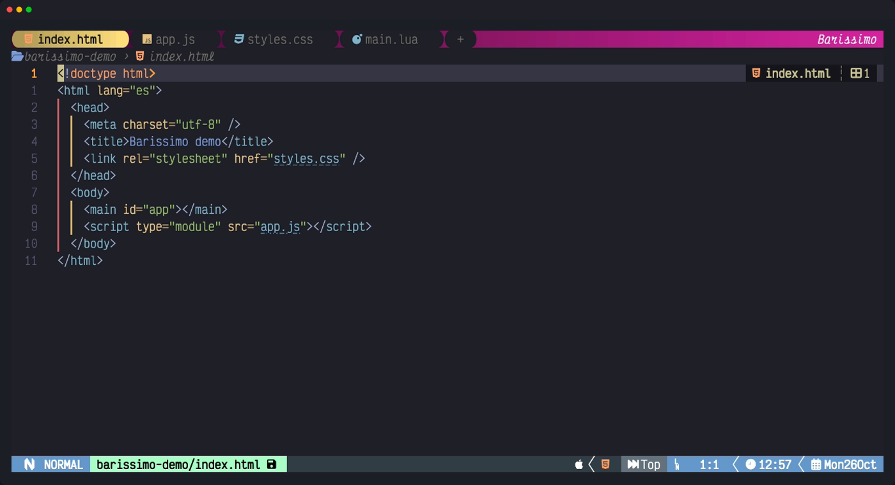
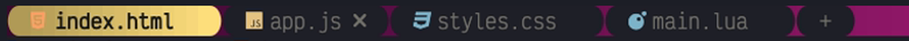
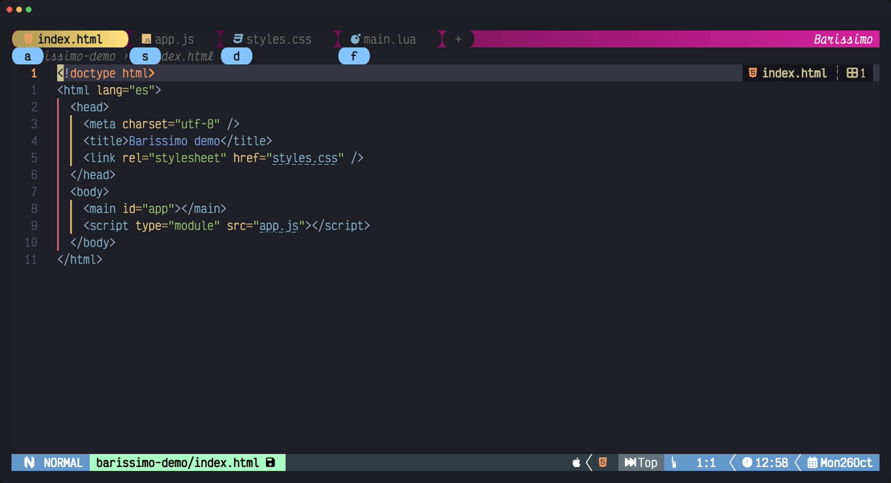
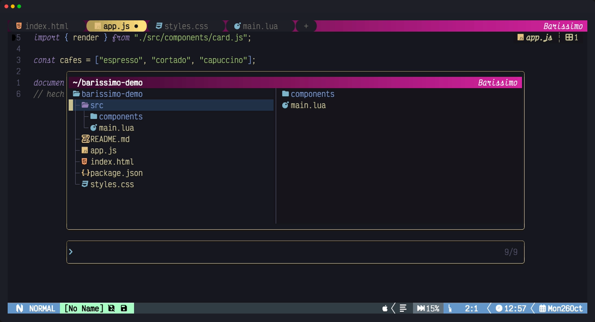
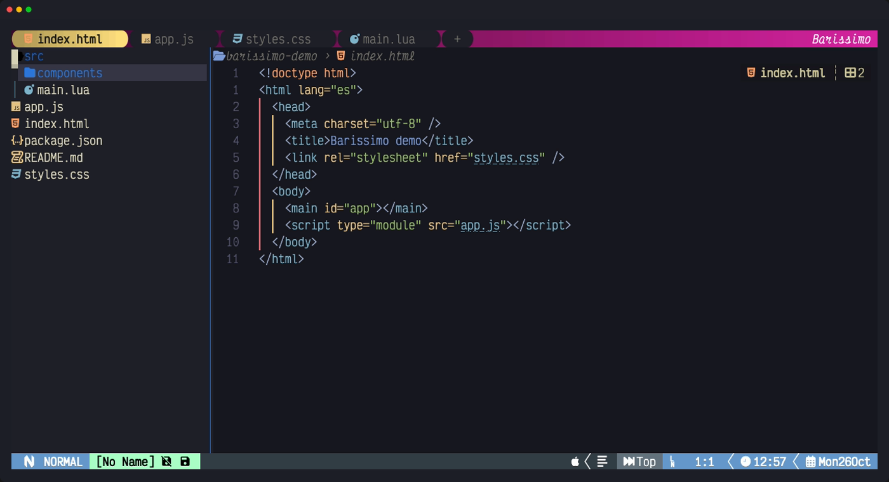

# Barissimo ☕

Una tabline elegante para Neovim, hecha de tarjetas redondeadas sobre un degradado de color, con selector rápido de pestañas, cierre y apertura con el ratón, un buscador de archivos con árbol y un explorador lateral con iconos.


## Qué incluye

### Tabline de tarjetas

Cada buffer abierto es una tarjeta con su icono de color. La activa resalta (aquí en amarillo, con `active_bg = "#FFDE7D"`), el fondo de la barra es un degradado configurable y la marca «Barissimo» va a la derecha.



- **Clic** en una tarjeta para cambiar a ella.
- Al **pasar el ratón** por encima aparece una `` para cerrarla (si hay cambios sin guardar, pregunta si quieres guardar, descartar o cancelar). Cerrar nunca cierra ventanas: muestran la pestaña vecina.

  

- `●` marca los buffers con cambios sin guardar.
- La tarjeta **`+`** abre el buscador para elegir un archivo nuevo.

### Selector rápido de pestañas

Pulsa `Alt+Space` y aparece una píldora con una letra debajo de cada pestaña. Pulsa la letra y saltas a ella; cualquier otra tecla cancela.



### Buscador de archivos con árbol

Con `Ctrl +` (o `Ctrl =`), o con un clic en la tarjeta `+`, se abre un buscador flotante con el árbol de archivos, la preview a la derecha, la carpeta actual en la barra superior y la búsqueda abajo.



| Tecla | Acción |
|---|---|
| `j` / `k` o flechas | moverse por el árbol |
| `Enter` | abrir el archivo (en pestaña nueva) o desplegar/plegar la carpeta |
| `Backspace` | subir a la carpeta padre |
| `/` | saltar a la búsqueda (ahí `Backspace` borra mientras escribes) |
| `Esc Esc` | cerrar |

En el árbol también funcionan los atajos del explorador de snacks: `a` crear, `r` renombrar, `d` borrar (pide confirmación), `c` copiar, `m` mover…

### Explorador lateral

`<leader>E` abre un explorador ligero a la izquierda, con iconos de color por tipo de archivo y carpetas en degradado.



| Tecla | Acción |
|---|---|
| `Enter` / `l` | abrir archivo o desplegar carpeta |
| `-` | subir a la carpeta padre |
| `R` | refrescar |
| `q` | cerrar |

## Requisitos

- **Neovim 0.10 o superior** (probado en 0.12).
- Una **[Nerd Font](https://www.nerdfonts.com/)** en tu terminal, para los iconos y los extremos redondeados.
- Una terminal con **color verdadero** (24 bits) y **ratón**: kitty, Alacritty, WezTerm, Ghostty, iTerm2…
- [nvim-web-devicons](https://github.com/nvim-tree/nvim-web-devicons) (o [mini.icons](https://github.com/echasnovski/mini.icons) con su modo de compatibilidad) para los iconos.
- Para el buscador: [snacks.nvim](https://github.com/folke/snacks.nvim) (recomendado). Sin snacks usa [telescope](https://github.com/nvim-telescope/telescope.nvim) si lo tienes, y si no, una lista simple.

## Instalación

Con [lazy.nvim](https://github.com/folke/lazy.nvim):

```lua
{
	"Gogiu23/Barissimo",
	dependencies = { "nvim-tree/nvim-web-devicons" },
	lazy = false,
	opts = {},
}
```

Con `opts = {}` ya funciona todo con los valores por defecto. Para el aspecto de la demo:

```lua
opts = {
	tabs = { active_bg = "#FFDE7D" },
},
```

> Barissimo sustituye la tabline de Neovim. Si usas **barbar** o **bufferline**, desactívalos.

## Atajos

| Tecla | Acción |
|---|---|
| `Alt+Space` | selector rápido de pestañas |
| `Ctrl +` / `Ctrl =` | buscador de archivos (igual que la tarjeta `+`) |
| `<leader>E` | abrir/cerrar el explorador lateral |
| clic | cambiar de pestaña, cerrar con la ``, abrir con `+` |

Todos se pueden cambiar en `opts.keys`.

### Notas para macOS y algunas terminales

- **`Alt` en macOS**: la terminal tiene que enviar Option como Alt.
  - Alacritty: `option_as_alt = "Both"`
  - kitty: `macos_option_as_alt yes`
  - iTerm2: *Profiles → Keys → Left Option key → Esc+*
- **`Ctrl +`**: solo se distingue en terminales con el protocolo de teclado de kitty (kitty, WezTerm, Ghostty, foot…). En el resto usa `Ctrl =`, que siempre funciona.
- **La `` al pasar el ratón**: Barissimo activa `mousemoveevent`; tu terminal tiene que enviar el movimiento del ratón (la mayoría lo hace).

## Configuración

Todas las opciones, con sus valores por defecto:

```lua
opts = {
	width = 30, -- ancho del explorador lateral
	keys = { toggle = "<leader>E", pick = "<M-Space>", new = { "<C-+>", "<C-=>" } },
	-- degradado azul: carpetas del explorador y su separador
	colors = { "#0a1f4d", "#123a8a", "#1f62c4", "#3d8cf0", "#86c5ff" },
	-- fondo de toda la tabline: lista de tonos o un solo color ("#d6249f") para degradarlo automáticamente
	bg_colors = { "#3a0b2e", "#5e1048", "#86165f", "#b01c84", "#d6249f" },
	brand = "Barissimo", -- "" para ocultarla
	brand_color = "#ffffff",
	tabs = {
		left = "\u{e0b6}", -- extremo izquierdo: redondeado; "\u{e0b2}" flecha; "" recto
		right = "\u{e0b4}", -- extremo derecho: redondeado; "\u{e0b0}" flecha; "" recto
		padding = 1, -- espacios dentro de la tarjeta a cada lado
		gap = 0, -- espacios entre tarjetas
		bg = nil, -- fondo de las inactivas: nil = el del colorscheme; un color o lista = degradado a lo ancho
		fg = nil, -- texto de las inactivas (nil = automático: Comment, u oscuro si el fondo es claro)
		active_bg = nil, -- fondo de la activa: igual que bg (p. ej. "#FFDE7D")
		active_fg = nil, -- texto de la activa (nil = automático: Normal, u oscuro si el fondo es claro)
		active_bold = true,
		close = "\u{f00d}", -- botón de cerrar (aparece al pasar el ratón)
		modified = "●", -- marca de cambios sin guardar
		new = "+", -- tarjeta para abrir otro archivo
		on_new = nil, -- función al pulsar +; nil = buscador de snacks, telescope o lista simple
	},
	-- popups del selector (Alt+Space): píldoras con la letra de cada pestaña
	picker = {
		left = "\u{e0b6}",
		right = "\u{e0b4}",
		padding = 1,
		bg = "#86c5ff",
		fg = nil, -- nil = automático (oscuro si el fondo es claro)
	},
	-- buscador (snacks): bordes redondeados en degradado, preview y barra con la carpeta actual
	finder = {
		width = 0.8, -- fracción del editor
		height = 0.7,
		preview = 0.55, -- ancho de la preview dentro del buscador
		border_color = "#FFDE7D", -- degradado diagonal de su tono oscuro a su tono claro
	},
}
```

### Ejemplos

Fondo de la tabline degradado a partir de un solo color:

```lua
opts = { bg_colors = "#00b4d8" }
```

Tarjetas con forma de flecha y un poco de aire entre ellas:

```lua
opts = { tabs = { left = "\u{e0b2}", right = "\u{e0b0}", gap = 1 } }
```

El `+` abre los archivos recientes en lugar del árbol:

```lua
opts = { tabs = { on_new = function() Snacks.picker.recent() end } }
```

## Desarrollo local

Para probar cambios sin hacer push, apunta lazy a tu copia local:

```lua
{
	dir = "~/ruta/a/Barissimo",
	name = "Barissimo",
	dependencies = { "nvim-tree/nvim-web-devicons" },
	lazy = false,
	opts = {},
}
```
